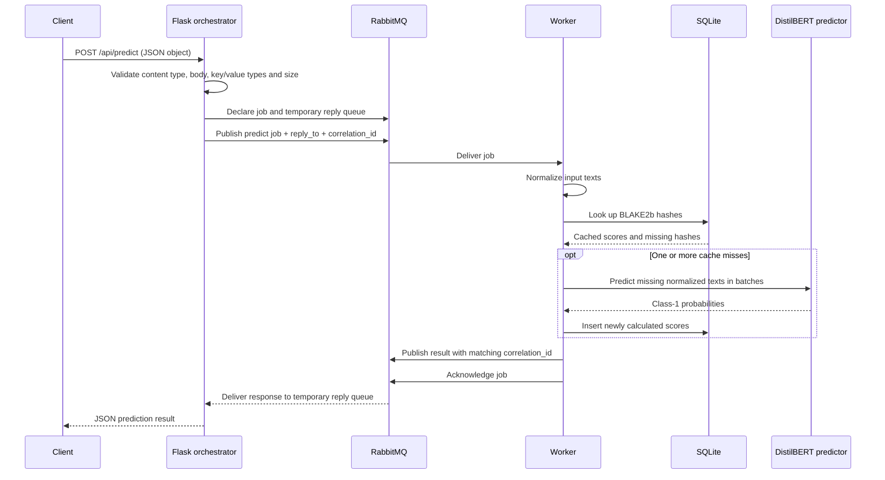
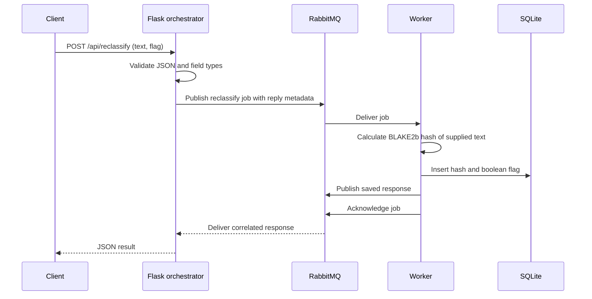

# Hate-Speech Detection Backend

This folder contains the backend service for a hate-speech detection system. It accepts text-classification requests over HTTP, dispatches work through RabbitMQ, runs a saved DistilBERT sentence-classification model, and stores prediction-cache and user-feedback records in SQLite.

This documentation describes the backend implementation included in this repository. The model-training code, curated training datasets, label definitions, and model evaluation results are not included in other folders.

## Table of contents

- [Project overview](#project-overview)
- [Architecture and request flow](#architecture-and-request-flow)
- [Project structure and code reference](#project-structure-and-code-reference)
- [Technologies and requirements](#technologies-and-requirements)
- [Model setup](#model-setup)
- [Installation and startup](#installation-and-startup)
- [Commands and operating the backend](#commands-and-operating-the-backend)
- [Configuration](#configuration)
- [HTTP API](#http-api)
- [Prediction and preprocessing pipeline](#prediction-and-preprocessing-pipeline)
- [Persistence and caching](#persistence-and-caching)
- [Worker lifecycle and messaging details](#worker-lifecycle-and-messaging-details)
- [Load-test utility](#load-test-utility)
- [Operational notes and implementation boundaries](#operational-notes-and-implementation-boundaries)

## Project overview

The backend is divided into several cooperating components:

- **Flask orchestrator (`orchestrator.py`)** exposes the HTTP API, validates incoming requests, and coordinates request/reply messages through RabbitMQ.
- **RabbitMQ worker (`app.py`)** consumes queued jobs, dispatches prediction or reclassification tasks, and publishes responses.
- **Model inference (`predict.py`)** loads the Hugging Face tokenizer and sequence-classification model and performs batched inference with PyTorch.
- **Text preprocessing (`normalize.py`)** normalizes input text and handles selected Unicode and obfuscation patterns before inference.
- **Persistence (`database.py`)** stores cached prediction scores and user-provided flags in SQLite.
- **Configuration (`config.py`)** reads paths, request limits, and RabbitMQ connection settings from environment variables.
- **Load-test utility (`TEST_ORCHESTRATOR.py`)** sends concurrent synthetic requests to the prediction endpoint and checks the response structure.

The orchestrator and worker are separate processes. The orchestrator communicates with clients over HTTP; the worker communicates with the orchestrator through RabbitMQ. The worker does not expose its own HTTP endpoint.

## Architecture and request flow

### Component responsibilities

| Component | Responsibility | Main interface |
|---|---|---|
| Flask orchestrator | Validates HTTP input and coordinates request/reply messaging | `POST /api/predict`, `POST /api/reclassify` |
| RabbitMQ | Buffers jobs and transports worker replies | Durable job queue and per-request reply queue |
| Worker | Dispatches jobs to prediction or feedback handling | RabbitMQ consumer callback |
| Normalization | Converts input text into the form used for inference | `normalize_all_apply(text)` |
| Predictor | Loads DistilBERT and returns class-index-1 probabilities | `HateSpeechPredictor.predict(texts)` |
| SQLite database | Caches scores and records user flags | `hash_scores`, `hash_flags` |

The orchestrator and worker run as separate processes. The orchestrator exposes the HTTP API to clients and communicates with the worker through RabbitMQ. The worker consumes messages from the configured queue; it does not expose its own HTTP endpoint.

### Prediction request sequence



1. A client sends a JSON request to the Flask orchestrator.
2. The orchestrator validates the request and publishes a job to the configured durable RabbitMQ queue.
3. The orchestrator creates a temporary exclusive reply queue and uses a UUID correlation ID to associate the response with the request.
4. The worker consumes the job. For prediction jobs, it normalizes the texts, checks the SQLite score cache, and runs model inference for cache misses.
5. The worker publishes a `result` or `error` response to the supplied reply queue and acknowledges the consumed job.
6. The orchestrator returns the result to the HTTP client, or returns an error/timeout status.

### Reclassification request sequence



1. A client sends text and a boolean-like flag to `POST /api/reclassify`.
2. The orchestrator validates the JSON body and field types, then publishes a `reclassify` job.
3. The worker calculates a BLAKE2b hash of the supplied text and stores the hash and flag in `hash_flags`.
4. The worker publishes a response to the request's reply queue and acknowledges the job.
5. The orchestrator returns the worker response to the client.

Reclassification records user feedback. It does not retrain the model, update the prediction-score cache, or alter the model's predictions in the supplied implementation.

### RabbitMQ request/reply mechanism

The orchestrator creates a UUID correlation ID for each job. It declares the configured durable job queue and a server-named exclusive, auto-delete reply queue. The request message includes `reply_to` and `correlation_id` properties. The orchestrator consumes from the reply queue and accepts only a response whose correlation ID matches the current request.

The orchestrator waits for up to 60 seconds (`REPLY_TIMEOUT_SECONDS`) while processing RabbitMQ events in short intervals. The worker reads the same properties from the delivered message. When both `reply_to` and `correlation_id` are present, it publishes the response to that reply queue and copies the correlation ID to the response. It then acknowledges the original job delivery.

### Prediction and cache path

The worker normalizes each text with `normalize.normalize_all_apply`. It removes duplicate normalized strings while preserving order, computes a BLAKE2b digest for each unique string, and asks SQLite which hashes already have scores. Only cache misses are sent to `HateSpeechPredictor.predict`. Newly computed scores are inserted with conflict-ignore semantics. Finally, the worker reconstructs the score list in the order of the original text tuple and maps scores back to the request keys.

The predictor tokenizes batches with truncation, padding, and the configured maximum token length. It runs the model in evaluation mode under `torch.inference_mode()`, applies softmax to the model logits, and returns probability index `1` for each input. The meaning of output index `1` depends on the model's label mapping; the backend archive does not establish the human-readable label for that index.

### Worker lifecycle

The worker connects to RabbitMQ, declares the durable job queue, configures `basic_qos(prefetch_count=1)`, and starts consuming. A prefetch count of one limits each consumer to one unacknowledged message at a time. If the consuming loop exits with an exception, the worker logs the event, waits five seconds, and attempts to reconnect.

The `PORT` value read in the worker module's main block is not used to start a listener. The HTTP listener is started by the separate Flask orchestrator process.

### Data-store responsibilities

`hash_scores` stores a unique cached score for each 128-character lowercase hexadecimal hash. `hash_flags` stores 0/1 feedback flags and permits multiple rows for the same hash. The database accessor opens a SQLite connection per method call. The worker uses `Database.lock` around multi-step cache operations and flag insertion; the individual database methods do not acquire this lock internally.

See [Persistence and caching](#persistence-and-caching) for the table constraints and [Worker lifecycle and messaging details](#worker-lifecycle-and-messaging-details) for operational behavior.

### Architecture scope

These diagrams and descriptions represent the control and data flow visible in the supplied backend source. They do not describe model training, dataset curation, or external client implementation because those sources were not part of the supplied backend archive.

## Project structure and code reference

The following reference describes the purpose of each supplied source file and its main classes/functions. Detailed parameter and return-value documentation is also provided in docstrings inside the annotated Python files.

| File | Purpose |
|---|---|
| `app.py` | RabbitMQ worker and task handlers |
| `orchestrator.py` | Flask API and RabbitMQ request/reply coordination |
| `predict.py` | DistilBERT model loading and inference |
| `normalize.py` | Text normalization and obfuscation handling |
| `database.py` | SQLite cache and feedback persistence |
| `config.py` | Environment-based configuration |
| `TEST_ORCHESTRATOR.py` | Concurrent API load test |
| `link.txt` | Model archive location and expected extraction path |
| `hashes.db` | SQLite database file included in the supplied archive |

### `app.py` — RabbitMQ worker

`app.py` is the worker process. It consumes jobs from the configured RabbitMQ queue and dispatches them according to the task name in each message.

Main functions:

- **`predict_texts(texts)`** deduplicates normalized strings, checks the SQLite score cache, predicts missing values, and restores input ordering.
- **`predict(payload)`** normalizes request values, invokes the cache/inference path, and preserves caller-supplied keys.
- **`reclassify(payload)`** hashes the submitted text and stores a user flag.
- **`callback(ch, method, properties, body)`** parses a RabbitMQ job, dispatches the task, publishes a correlated response, and acknowledges the delivery.
- **`start_consumer()`** maintains the RabbitMQ consumer connection and reconnect loop.

### `orchestrator.py` — Flask HTTP API

`orchestrator.py` defines the Flask application and the two HTTP endpoints.

Main functions:

- **`send_and_recieve_job(job)`** implements the RabbitMQ request/reply exchange and 60-second timeout. A UUID correlation ID associates the response with the request; a temporary exclusive, auto-delete reply queue is created for that request.
- **`api_predict()`** validates and dispatches prediction requests.
- **`api_reclassify()`** validates and dispatches feedback requests.

### `predict.py` — model inference

`predict.py` contains the reusable `HateSpeechPredictor` class.

- **`HateSpeechPredictor`** owns the tokenizer, model, selected compute device, and inference configuration.
- **`HateSpeechPredictor.__init__(...)`** selects CUDA when available (otherwise CPU), loads the saved tokenizer and model from `MODEL_DIR`, moves the model to the selected device, and switches it to evaluation mode.
- **`HateSpeechPredictor.predict(texts)`** tokenizes and predicts in batches, returning softmax probability index `1` for each input.

The predictor uses truncation, padding, and the configured maximum token length. Inference runs under `torch.inference_mode()`. The meaning of output index `1` depends on the model's label mapping; consult the model configuration before interpreting it as a specific class.

### `normalize.py` — text preprocessing

`normalize.py` contains helper functions for text cleanup and obfuscation normalization.

Key helper groups include:

- **Structural token handling:** `_redact_structural_tokens` replaces recognized URLs and email addresses with placeholder tokens.
- **Punctuation and Unicode handling:** `_fix_punctuation`, `_strip_combining_marks`, `_fix_lookalikes`, and the Unicode normalization steps standardize selected character representations.
- **Obfuscation handling:** `_leetspeak_word`, `_looks_upside_down`, `_fix_upside_down`, and `_decode_flip_char` handle configured leetspeak, upside-down text, and selected superscript/subscript characters.
- **Emoji and character filtering:** `_strip_emoji` and `_only_printable` remove characters matched by the configured patterns or not retained by the final filter.
- **Whitespace and separator handling:** configured regular expressions normalize selected wide spaces, zero-width characters, repeated characters, and separators between word characters.

Main public functions:

- **`normalize_text(text)`** applies the main Unicode and obfuscation normalization pipeline.
- **`normalize_to_ascii(text)`** additionally decomposes and encodes normalized text as ASCII, ignoring characters that cannot be represented.
- **`drop_RT(text)`** removes the exact substring ` RT `.
- **`replace_at_usernames(text)`** replaces `@`-prefixed word-character usernames with a `user` placeholder.
- **`remove_ampersand_with_hashtag_numbers(text)`** removes HTML-style numeric references matching `&#digits;`.
- **`remove_andamp(text)`** replaces the literal `&amp;` entity with `and`.
- **`fix_beginning_end_quotes(text)`** removes matching single or double quote characters at both ends of the entire string; otherwise it strips surrounding whitespace.
- **`normalize_all_apply(text, keep_usernames=True)`** combines the cleanup helpers in the order implemented and is the preprocessing entry point used by the worker.

The order of transformations in `normalize_text` and `normalize_all_apply` is significant and is documented in the source. The normalization functions are deterministic text transformations; they do not perform classification themselves.

### `database.py` — SQLite persistence

`database.py` defines the `Database` class, which provides access to the SQLite cache and feedback tables.

Main methods:

- **`Database.__init__(db_path=DB_PATH)`** stores the database path, creates a threading lock, and initializes the tables.
- **`initialize()`** creates `hash_scores` and `hash_flags` if they do not already exist.
- **`connect()`** opens a SQLite connection to the configured database path.
- **`insert_scores(text_scores)`** inserts cached scores and ignores conflicts for hashes that already exist.
- **`insert_flag(hash, flag)`** inserts a user feedback flag.
- **`get_scores(hashes)`** returns a mapping of cache hits and a list of hashes that are missing.
- **`get_all_flags()`** retrieves all stored hash/flag pairs and converts the stored integer flags to booleans.

The worker uses `Database.lock` around combined cache operations and flag insertion. The individual database methods do not acquire this lock internally.

### `config.py` — configuration

`config.py` defines configuration values from environment variables and defaults, including:

- `MODEL_DIR`
- `DB_PATH`
- `MAX_BATCH_SIZE`
- `MAX_REQUEST_LENGTH`
- `JOB_QUEUE`
- `CONNECTION_PARAMETERS`

Model inference also reads `MAX_LENGTH` and `INFERENCE_BATCH_SIZE` in `predict.py`.

### `TEST_ORCHESTRATOR.py` — concurrent API load test

Main functions:

- **`make_fake_text(number)`** builds one synthetic keyed request payload.
- **`send_request(payload)`** sends one HTTP request and validates the response structure.
- **Module-level execution** submits the configured request count through a thread pool and reports failures and average latency.

The test generates random alphanumeric text and checks response shape and score types/ranges. It does not evaluate classification accuracy or model quality. See [Load-test utility](#load-test-utility) for the current run settings.

## Technologies and requirements

The source imports the following third-party packages:

- `Flask`
- `pika` (RabbitMQ client)
- `torch`
- `transformers`
- `requests` (used by the load-test script)

Python's standard library is also used. Install compatible versions of these packages in your environment. The supplied archive does not include a dependency lockfile or requirements file, so exact package versions cannot be inferred from this repository alone.

The backend also requires a running RabbitMQ instance and the saved Hugging Face model/tokenizer files.

## Model setup

The model archive URL recorded in `link.txt` is:

`https://jelte2357.nl/distilbert_classifier.zip`

The instructions in that file specify that the extracted directory should be:

`outputs/distilbert_classifier`

The resulting directory should contain the Hugging Face model/tokenizer files expected by `AutoTokenizer.from_pretrained` and `AutoModelForSequenceClassification.from_pretrained`. Avoid creating an extra nested `distilbert_classifier/distilbert_classifier` directory.

The model path can be overridden with the `MODEL_DIR` environment variable.

## Installation and startup

### 1. Prepare the Python environment

Create and activate a Python environment using your preferred environment manager, then install compatible versions of the packages listed in [Technologies and requirements](#technologies-and-requirements). No requirements file or dependency lockfile was included in the supplied archive, so exact package versions cannot be inferred from this repository alone.

### 2. Start RabbitMQ

The supplied commands use the RabbitMQ 4 management image. In PowerShell, create and start the container with:

```powershell
docker run -d --name rabbitmq-poc `
  -p 5672:5672 `
  -p 15672:15672 `
  rabbitmq:4-management
```

For a container that has already been created, start it with:

```powershell
docker start rabbitmq-poc
```

The management interface is available at:

`http://localhost:15672/#/`

The worker connects to RabbitMQ on `localhost:5672` by default. The RabbitMQ image's default development credentials are used unless the container or application configuration has been changed.

### 3. Start the worker

In a terminal opened in the backend directory, run:

```powershell
python app.py
```

The worker consumes jobs from RabbitMQ. It does not start an HTTP server.

### 4. Start the Flask orchestrator

In a second terminal, also from the backend directory, run:

```powershell
python orchestrator.py
```

The orchestrator exposes the HTTP API on `0.0.0.0:4352` when run directly.

### 5. Run the API load test

Once RabbitMQ, the worker, and the orchestrator are running, open another terminal in the backend directory and run:

```powershell
python TEST_ORCHESTRATOR.py
```

The test sends concurrent requests to the orchestrator. See [Load-test utility](#load-test-utility) for the request count, concurrency, timeout, and the checks it performs.

## Commands and operating the backend

This section consolidates the supplied local commands and explains what they do. The examples are PowerShell commands, matching the original command notes.

### Start-up order

For a normal local run, start the components in this order:

1. Start the RabbitMQ container.
2. Start one or more worker processes with `python app.py`.
3. Start the Flask orchestrator with `python orchestrator.py`.
4. Run `python TEST_ORCHESTRATOR.py` when you want to exercise the API.

The orchestrator and workers are separate processes. Keep their terminals open while using the service.

### Optional: start two worker processes

The supplied command notes include these examples for starting two worker processes with separate SQLite database paths:

**Worker 1**

```powershell
$env:DB_PATH = "$PWD\worker1.db"
python app.py
```

**Worker 2**

```powershell
$env:DB_PATH = "$PWD\worker2.db"
python app.py
```

### RabbitMQ management interface

Open the management interface in a browser:

`http://localhost:15672/#/`

The AMQP connection used by the backend is configured separately through the RabbitMQ environment variables described in [Configuration](#configuration).

## Configuration

The following settings are read from environment variables and have defaults in `config.py` or `predict.py`.

| Variable | Default | Used for |
|---|---|---|
| `MODEL_DIR` | `<backend>/outputs/distilbert_classifier` | Saved model/tokenizer directory |
| `DB_PATH` | `<backend>/hashes.db` | SQLite database file |
| `MAX_BATCH_SIZE` | `128` | Defined in configuration; not referenced elsewhere in the supplied Python files |
| `MAX_REQUEST_LENGTH` | `5000` | Maximum number of key/value text entries accepted by `/api/predict` |
| `RABBITMQ_QUEUE` | `prediction_jobs` | RabbitMQ job queue name |
| `RABBITMQ_HOST` | `localhost` | RabbitMQ host |
| `RABBITMQ_PORT` | `5672` | RabbitMQ AMQP port |
| `RABBITMQ_USER` | `guest` | RabbitMQ username |
| `RABBITMQ_PASSWORD` | `guest` | RabbitMQ password |
| `MAX_LENGTH` | `256` | Maximum token length passed to the tokenizer |
| `INFERENCE_BATCH_SIZE` | `64` | Number of texts processed per model batch |
| `PORT` | `4352` | Read by `app.py` at startup but not used to bind a network listener |

`WORKER_ID` appears in the supplied multi-worker examples, but is not read by the worker implementation. The `PORT` and `WORKER_ID` examples therefore do not, by themselves, configure distinct HTTP worker instances. Workers share the configured RabbitMQ queue; each process uses the configured `DB_PATH`.

## HTTP API

Both endpoints expect JSON requests with `Content-Type: application/json`.

### `POST /api/predict`

Expects a JSON object whose keys and values are strings. Each key is preserved in the response and each value is classified.

Example request:

```json
{
  "sample_1": "Example text to classify",
  "sample_2": "Another example"
}
```

A successful response is a JSON object mapping the submitted keys to floating-point scores. The worker returns `probability[1]` from the model's softmax output; consult the model's label mapping before interpreting that value as a particular class.

Validation and failure statuses implemented by the endpoint:

| Status | Meaning in the implementation |
|---|---|
| `200` | Successful prediction, or an empty input object |
| `400` | Request is not JSON, or body is not a JSON object |
| `413` | More than `MAX_REQUEST_LENGTH` entries |
| `418` | A key or value is not a string |
| `500` | Worker response contains an error |
| `503` | RabbitMQ/OS communication error; queue reported unavailable |
| `504` | No worker response before the reply timeout |

An empty JSON object is returned as an empty JSON response without publishing a job.

### `POST /api/reclassify`

Expects a JSON object with a string `text` and a `flag` that is a boolean or integer `0`/`1`.

Example request:

```json
{
  "text": "Text that a user wants to flag",
  "flag": true
}
```

The worker stores a BLAKE2b hash and the supplied flag in `hash_flags`. This endpoint does **not** retrain the model or modify `hash_scores`.

Implemented statuses include:

| Status | Meaning in the implementation |
|---|---|
| `200` | Feedback record successfully processed |
| `400` | Request is not JSON, or body is not a JSON object |
| `418` | Required fields have invalid types/values |
| `500` | Worker response contains an error |
| `503` | RabbitMQ/OS communication error; queue reported unavailable |
| `504` | No worker response before the reply timeout |

## Prediction and preprocessing pipeline

The prediction worker uses `normalize_all_apply` as the preprocessing entry point. It normalizes each input text before calculating its BLAKE2b hash and checking the score cache.

The worker removes duplicate normalized strings while preserving their order. It looks up the corresponding hashes in SQLite and sends only cache misses to `HateSpeechPredictor.predict`. Newly calculated scores are inserted into the cache. Finally, the worker reconstructs the scores in the order of the original input texts and maps them back to the caller-supplied keys.

The predictor tokenizes batches with truncation, padding, and the configured maximum token length. It runs the model in evaluation mode under `torch.inference_mode()`, applies softmax to the model logits, and returns probability index `1` for each input.

The normalization pipeline includes the transformations implemented in `normalize.py`, such as:

- Retweet-marker handling and optional username replacement.
- Replacement of recognized URLs and email addresses with structural placeholder tokens.
- Selected HTML entity handling.
- Punctuation normalization and Unicode NFKC normalization.
- Removal of selected combining marks, emojis, variation selectors, zero-width characters, and non-printable characters.
- Normalization of selected wide spaces and separators.
- Reduction of repeated characters.
- Mapping of configured Cyrillic and Greek lookalikes.
- Detection and decoding of selected upside-down, superscript, and subscript text.
- Leetspeak conversion under the conditions implemented by `_leetspeak_word`.

The exact order and conditions are defined in the source code. These transformations should not be interpreted as a guarantee that every possible obfuscation is detected or normalized.

## Persistence and caching

SQLite contains two tables.

### `hash_scores`

Stores one cached score per hash.

- `hash` is the primary key.
- The hash is constrained to 128 lowercase hexadecimal characters.
- `score` is constrained to the inclusive range `0.0`–`1.0`.
- Inserts use conflict-ignore semantics, so an existing score is not replaced by a new insert for the same hash.

### `hash_flags`

Stores user-provided feedback flags.

- Each row contains an integer ID, a hash, and a 0/1 flag.
- The hash is constrained to 128 lowercase hexadecimal characters.
- The table does not declare the hash unique, so multiple flags for the same hash can be stored.

The worker hashes normalized prediction text with BLAKE2b before looking up cached scores. Repeated normalized texts in one prediction payload are deduplicated for inference, while output values are restored to the original input order.

The database accessor opens a SQLite connection per method call. The worker uses the `Database.lock` around combined cache operations and flag insertion; the individual database methods do not acquire the lock internally.

## Worker lifecycle and messaging details

The worker connects to RabbitMQ, declares the durable job queue, configures `basic_qos(prefetch_count=1)`, and starts consuming. A prefetch count of one limits each consumer to one unacknowledged message at a time.

If the consuming loop exits with an exception, the worker logs the event, waits five seconds, and attempts to reconnect.

For a request/reply message, the worker reads the `reply_to` and `correlation_id` properties. When both are present, it publishes the response to the reply queue and copies the correlation ID to the response. The worker then acknowledges the original job delivery.

## Load-test utility

Run the script with:

```powershell
python TEST_ORCHESTRATOR.py
```

The current constants configure 100 requests, 60 texts per request, 10 concurrent threads, and a 10-second HTTP timeout.

The script generates random alphanumeric text and checks that successful responses contain exactly the submitted keys and float scores in the range `[0.0, 1.0]`. This tests API throughput and response shape, not classification accuracy or model quality.

## Operational notes and implementation boundaries

- The orchestrator's reply timeout is 60 seconds (`REPLY_TIMEOUT_SECONDS`).
- The worker sets RabbitMQ prefetch to one unacknowledged message per consumer.
- The worker retries its consumer connection after an exception, waiting five seconds between attempts.
- The database lock is used by the worker around combined cache/feedback operations; the individual database methods do not acquire it internally.
- `MAX_BATCH_SIZE` is defined but not referenced in the supplied Python files. Actual model inference batching is controlled by `INFERENCE_BATCH_SIZE`.
- `PORT` is read by `app.py` but is not used to start a Flask or other HTTP server.
- `WORKER_ID` appears in sample commands but is not read by the supplied worker implementation.
- The source archive contains `hashes.db` but not the trained model directory or a Python dependency lockfile.
- The model-training code, training datasets, label definitions, and model evaluation results are not included in this backend archive.

---

This README consolidates the project overview, architecture, source-file reference, setup instructions, and operational commands. It is the central documentation entry point for the supplied backend.
