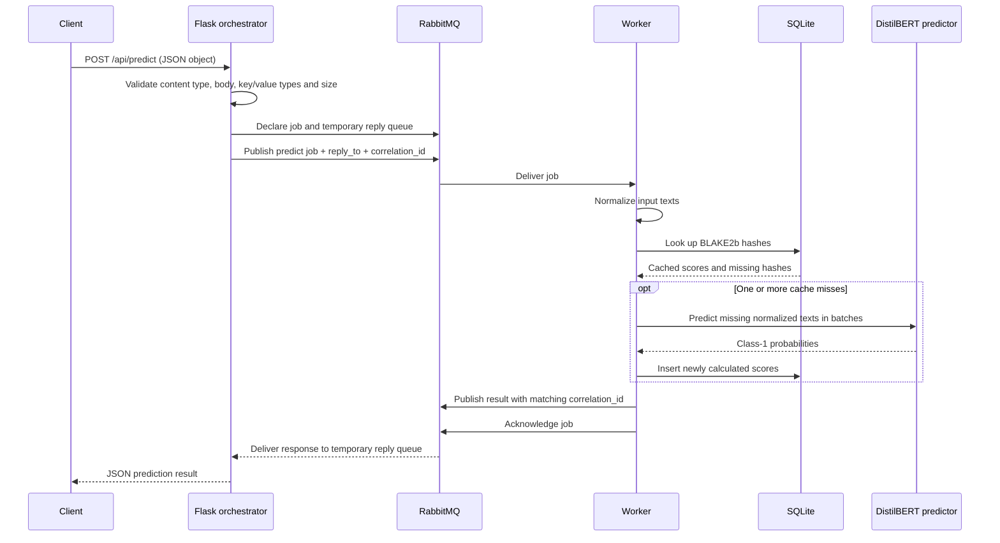
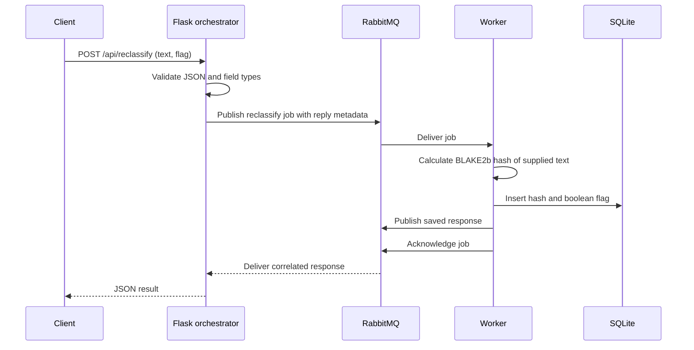

# Backend Architecture

## Component responsibilities

| Component | Responsibility | Main interface |
|---|---|---|
| Flask orchestrator | Validates HTTP input and coordinates request/reply messaging | `POST /api/predict`, `POST /api/reclassify` |
| RabbitMQ | Buffers jobs and transports worker replies | Durable job queue and per-request reply queue |
| Worker | Dispatches jobs to prediction or feedback handling | RabbitMQ consumer callback |
| Normalization | Converts input text into the form used for inference | `normalize_all_apply(text)` |
| Predictor | Loads DistilBERT and returns class-1 probabilities | `HateSpeechPredictor.predict(texts)` |
| SQLite database | Caches scores and records user flags | `hash_scores`, `hash_flags` |

## Prediction request sequence

## Reclassification request sequence

## RabbitMQ request/reply details

The orchestrator creates a UUID correlation ID for each job. It declares the configured durable job queue and a server-named exclusive, auto-delete reply queue. The request message includes `reply_to` and `correlation_id` properties. The orchestrator consumes from the reply queue and accepts only a response whose correlation ID matches the current request. It waits for up to 60 seconds while processing RabbitMQ events in short intervals.

The worker reads the same properties from the delivered message. When both `reply_to` and `correlation_id` are present, it publishes the response to that reply queue and copies the correlation ID to the response. It then acknowledges the original job delivery.

## Prediction and cache path

The worker normalizes each text with `normalize.normalize_all_apply`. It removes duplicate normalized strings while preserving order, computes a BLAKE2b digest for each unique string, and asks SQLite which hashes already have scores. Only cache misses are sent to `HateSpeechPredictor.predict`. Newly computed scores are inserted with conflict-ignore semantics. Finally, the worker reconstructs the score list in the order of the original text tuple and maps scores back to the request keys.

The predictor tokenizes batches with truncation, padding, and the configured maximum token length. It runs the model in evaluation mode under `torch.inference_mode()`, applies softmax to the model logits, and returns probability index 1 for each input.

## Feedback path

The reclassification handler hashes the submitted text as supplied in the reclassification payload and inserts the hash and boolean flag into `hash_flags`. This path does not call the model, update the score cache, or trigger model training in the supplied backend.

## Worker lifecycle

The worker connects to RabbitMQ, declares the durable job queue, configures `basic_qos(prefetch_count=1)`, and starts consuming. If the consuming loop exits with an exception, the worker logs the event, waits five seconds, and attempts to reconnect. The `PORT` value read in the module's main block is not used to start a listener.

## Data stores

`hash_scores` stores a unique cached score for each 128-character lowercase hexadecimal hash. `hash_flags` stores 0/1 feedback flags and permits multiple rows for the same hash. The database accessor opens a SQLite connection per method call. The worker uses the `Database.lock` around multi-step cache operations and flag insertion.

## Diagram boundaries

These diagrams describe the control and data flow visible in the supplied backend source. They do not describe model training, dataset curation, or external client implementation because those sources were not part of the uploaded archive.
